# Resolveon — Backend

REST API for **Resolveon**, a collaborative bug tracking and project management application. The backend supports authentication, project and team management, ticket tracking, ticket assignment, filtering, and comments, with MongoDB as the data store.

---

## 1. Introduction — Backend

Resolveon's backend is responsible for handling application data and business logic, validating requests, protecting routes, and providing the frontend with API endpoints.

It is built with Node.js and Express, and uses MongoDB through Mongoose.

The backend acts as the bridge between the frontend and the database, ensuring that user authentication, project management, ticket operations, and team collaboration are handled securely and efficiently.

---

## 2. Research & Problem Understanding

Software projects need a reliable way to record bugs, organize them by project, assign responsibility, track progress, and keep discussion connected to the issue. Without a centralized workflow, issue details and updates can become scattered, making it harder for teams to understand what needs attention and what has already been resolved.

Resolveon addresses this workflow with a backend API that supports:

- Project creation and team collaboration
- Tickets with priority and status tracking
- Assignment of tickets to team members
- Ticket filtering by status, priority, and assignee
- Keyword-based ticket search
- Comments attached to tickets for discussion and context
- Authenticated access to protected resources

The API is designed around related resources — users, projects, tickets, and comments — so the frontend can manage them through focused endpoints.

---

## 3. Tech Stack & Why

| Technology | Why it is used |
|---|---|
| **Node.js** | JavaScript runtime for building the backend and handling asynchronous I/O. |
| **Express.js** | Lightweight framework for defining API routes, middleware, and request/response handling. |
| **MongoDB** | Document database for storing users, projects, tickets, and comments. |
| **Mongoose** | MongoDB object modeling, schemas, validation, references, population, and query operations. |
| **JSON Web Token (JWT)** | Token-based authentication for protected API requests. |

---

## 4. Libraries & Their Roles

| Library | Purpose in Resolveon |
|---|---|
| `express` | Creates the server and API routing layer. |
| `mongoose` | Defines schemas/models and connects to MongoDB. |
| `bcryptjs` | Hashes passwords during registration and compares password hashes during login. |
| `jsonwebtoken` | Signs JWTs at registration/login and verifies tokens in authentication middleware. |
| `dotenv` | Loads environment variables from a local `.env` file. |
| `cors` | Enables cross-origin requests from the frontend. |

---

## 5. Functionality — API Screenshots

The following screenshots document API testing performed with Postman. They are stored in the repository under `docs/`.

### 5.1 Authentication

Users can register and log in. Registration validates required fields and password rules, checks whether the email is already registered, hashes the password, and returns a JWT. Login verifies the email and password and returns a JWT for authenticated requests.

**Register API — Postman**

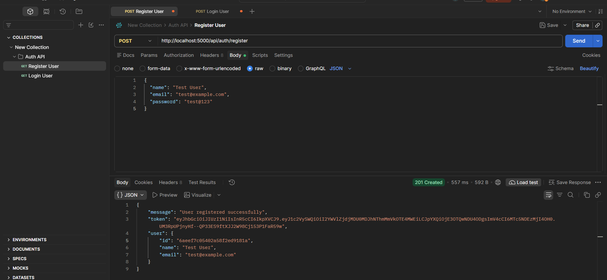

**Login API — Postman**

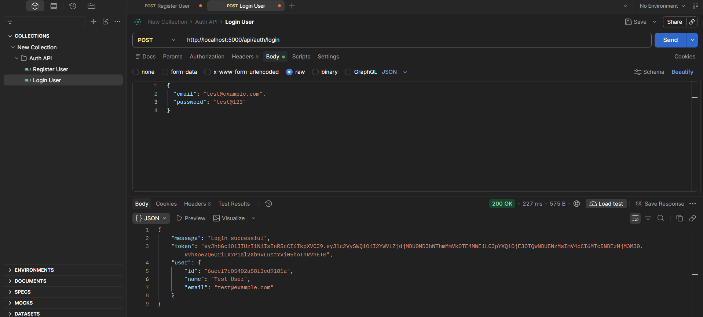

### 5.2 Project Management

Authenticated users can create projects, view projects they own or belong to, update or delete projects (owner-only operations), and add or remove team members.

**Create Project**

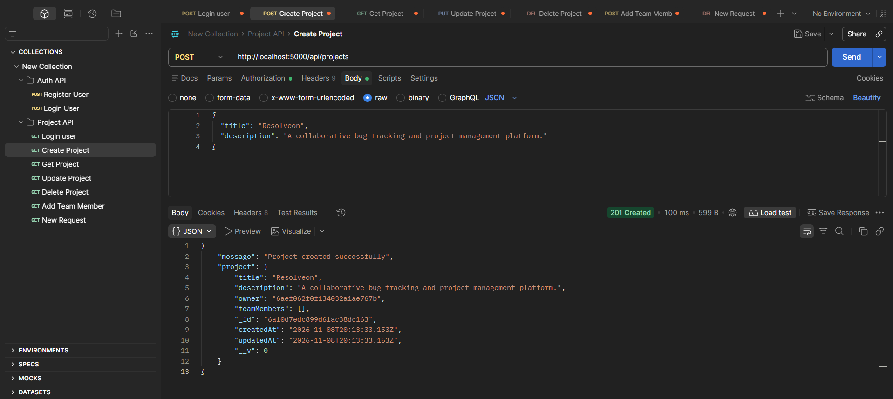

**Get Projects**

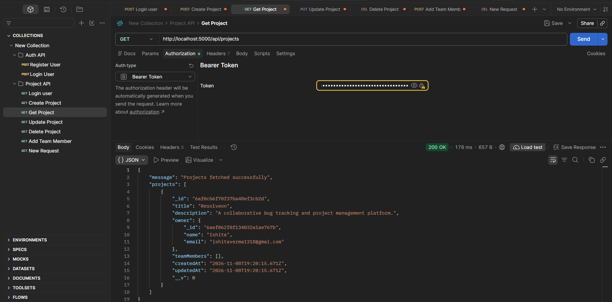

**Update Project**

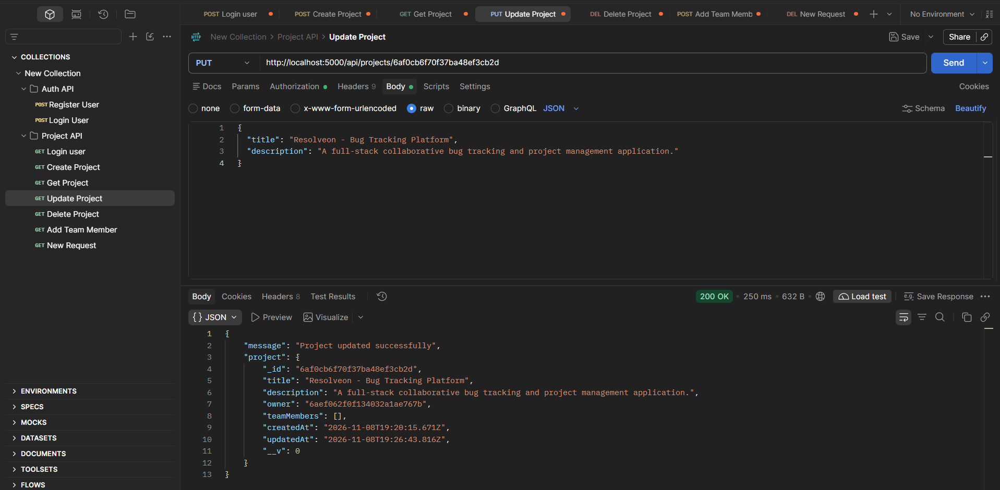

**Add Team Member**

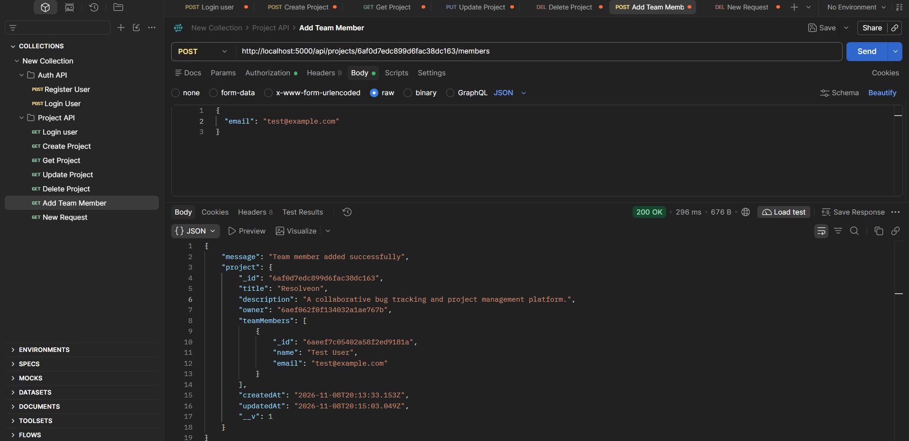

**Remove Team Member**

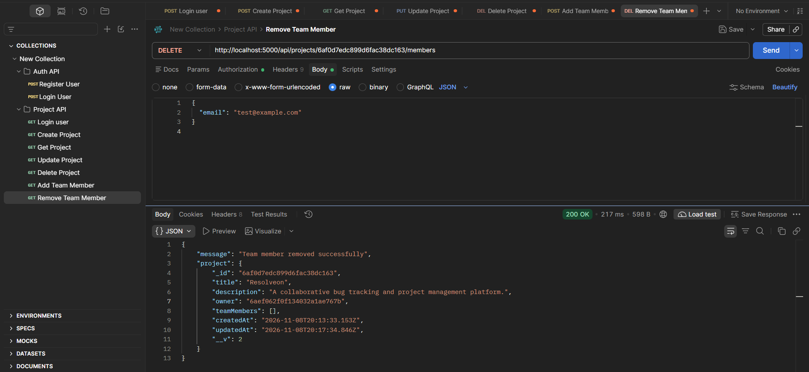

### 5.3 Ticket Management

Tickets belong to a project and include a title, description, priority, status, and optional assignee.

The API supports creating, listing tickets for a project, updating ticket details/status, deleting tickets, and assigning tickets. Project access is checked before project tickets are retrieved or modified.

**Create Ticket**

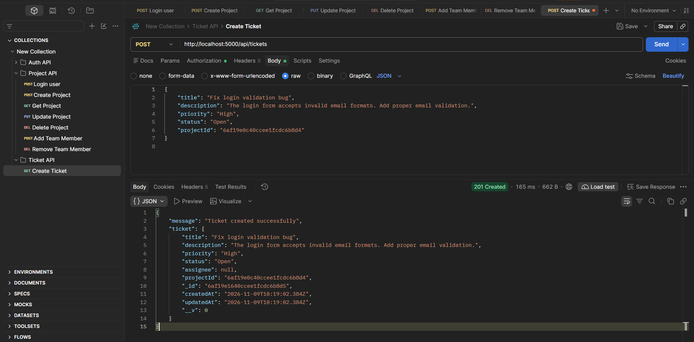

**Get Tickets by Project**

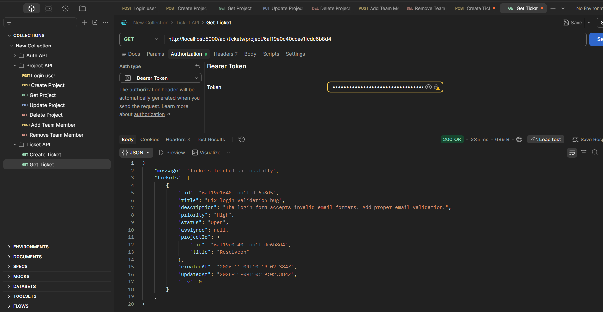

**Update Ticket**

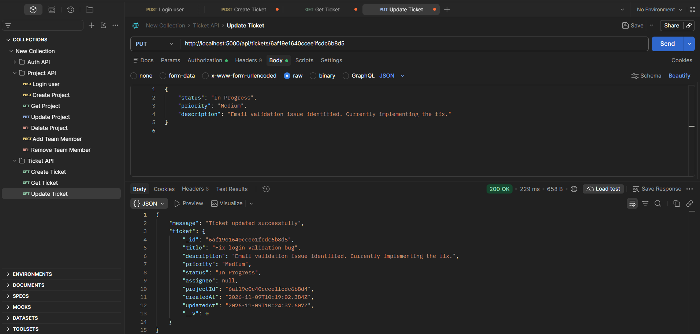

**Assign Ticket**

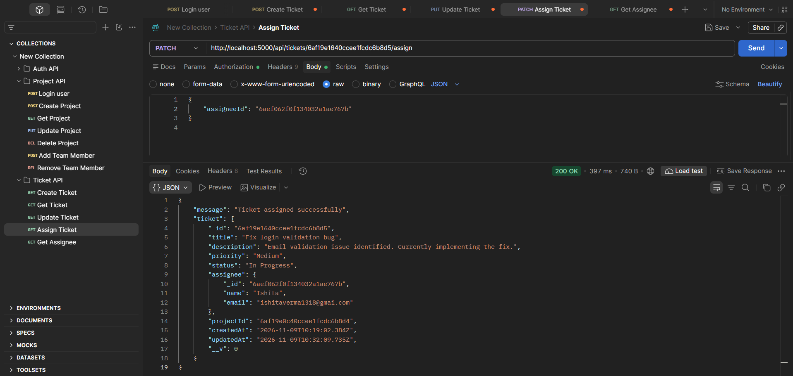

Tickets can also be filtered by status, priority, and assignee, and searched by keyword across title and description.

### 5.4 Ticket Comments

Authenticated users can add comments to a ticket and retrieve its discussion. Comment responses include the associated user information, and comments are returned in chronological order.

**Add Comment**

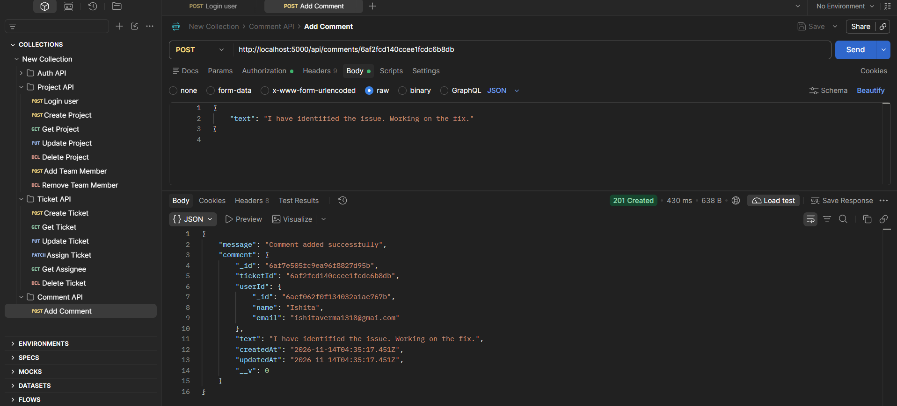

**Get Comments**

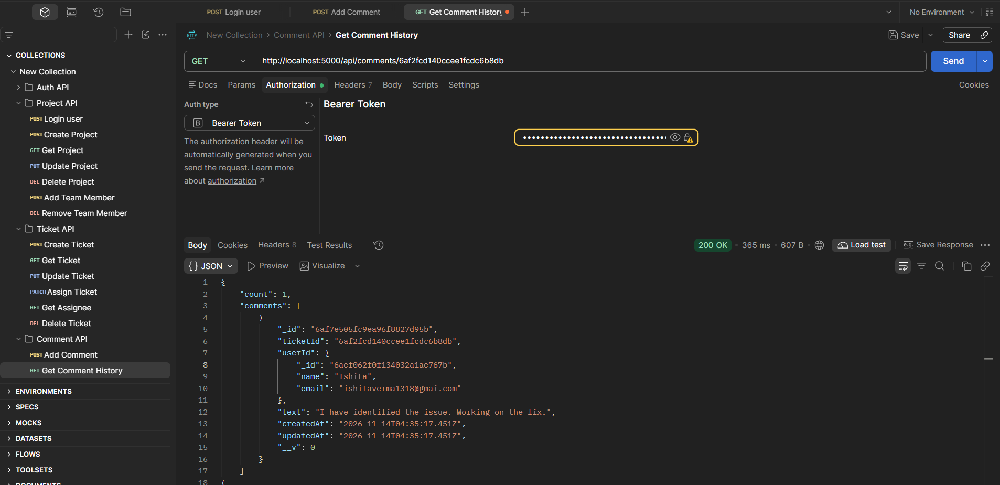

---

## 6. API Overview

All endpoints are relative to the deployed backend base URL. Protected endpoints require the token returned by registration or login.

```http
Authorization: Bearer <JWT_TOKEN>
```

### Authentication

| Method | Endpoint | Description | Auth |
|---|---|---|---|
| `POST` | `/api/auth/register` | Register a new user | No |
| `POST` | `/api/auth/login` | Log in | No |

### Projects

| Method | Endpoint | Description |
|---|---|---|
| `POST` | `/api/projects` | Create a project |
| `GET` | `/api/projects` | Get projects owned by or shared with the current user |
| `PUT` | `/api/projects/:id` | Update project (owner only) |
| `DELETE` | `/api/projects/:id` | Delete project (owner only) |
| `POST` | `/api/projects/:id/members` | Add a team member |
| `DELETE` | `/api/projects/:id/members` | Remove a team member |

### Tickets

| Method | Endpoint | Description |
|---|---|---|
| `POST` | `/api/tickets` | Create a ticket in a project |
| `GET` | `/api/tickets/project/:projectId` | Get project tickets; supports filters and search |
| `PUT` | `/api/tickets/:id` | Update ticket details, priority, or status |
| `DELETE` | `/api/tickets/:id` | Delete a ticket |
| `PATCH` | `/api/tickets/:id/assign` | Assign or unassign a ticket |

Ticket listing query parameters:

- `status`
- `priority`
- `assignee`
- `search`

### Comments

| Method | Endpoint | Description |
|---|---|---|
| `POST` | `/api/comments/:ticketId` | Add a comment to a ticket |
| `GET` | `/api/comments/:ticketId` | Get comments for a ticket |

---

## 7. Data Models

### User

- `name`
- `email` (unique, normalized to lowercase)
- `password` (stored as a hash)

### Project

- `title`
- `description`
- `owner` (User reference)
- `teamMembers` (User references)

### Ticket

- `title`
- `description`
- `priority` — `Low`, `Medium`, or `High`
- `status` — `Open`, `In Progress`, `Resolved`, or `Closed`
- `assignee` (optional User reference)
- `projectId` (Project reference)

### Comment

- `ticketId` (Ticket reference)
- `userId` (User reference)
- `text`

Models use Mongoose timestamps for `createdAt` and `updatedAt`.

---

## 8. Local Setup

### Prerequisites

- Node.js and npm
- MongoDB database (local or MongoDB Atlas)

### Installation

```bash
git clone <BACKEND_REPOSITORY_URL>
cd Bug-Tracker-Backend
npm install
```

Create a `.env` file in the backend root:

```env
PORT=5000
MONGO_URI=<YOUR_MONGODB_CONNECTION_STRING>
JWT_SECRET=<YOUR_SECRET_KEY>
```

Start the development server:

```bash
npm run dev
```

Start the production server:

```bash
npm start
```

### Health Check

```http
GET /
```

Deployed backend:

**https://resolveon-bug-tracker-backend.onrender.com**

---

## 9. Project Structure

```text
Bug-Tracker-Backend/
├── controllers/
│   ├── authController.js
│   ├── commentController.js
│   ├── projectController.js
│   └── ticketController.js
├── middleware/
│   └── authMiddleware.js
├── models/
│   ├── Comment.js
│   ├── Project.js
│   ├── Ticket.js
│   └── User.js
├── routes/
│   ├── authRoutes.js
│   ├── commentRoutes.js
│   ├── projectRoutes.js
│   └── ticketRoutes.js
├── docs/
│   ├── day-2/
│   ├── day-3/
│   ├── day-4/
│   └── day-9/
├── server.js
└── package.json
```

---

## 10. Conclusion

Resolveon's backend provides the API foundation for project collaboration and bug tracking. By separating routes, controllers, models, and middleware, the application keeps request handling, business logic, data structure, and authentication responsibilities organized.

The API connects the frontend to persistent project, ticket, and comment data and supports the core workflow of creating issues, assigning them, tracking progress, and discussing resolutions.

---

**Frontend Repository:** `<FRONTEND_REPOSITORY_URL>`

**Live Application:** `<FRONTEND_DEPLOYMENT_URL>`
